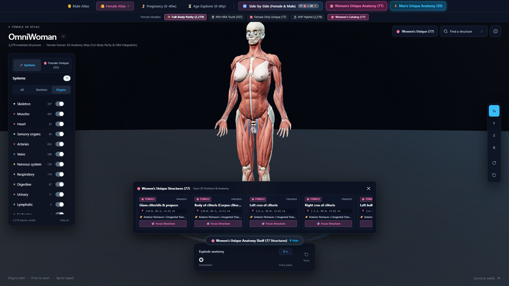

# OmniWoman 3D: Female Human Anatomy Atlas & Dual-Gender Explorer
**Interactive 3D Female Anatomical Digital Twin & Side-by-Side Comparative Explorer**

[](https://humanatlas.io/)
[]()
[]()

---

## 📸 Workstation Interface



---

## 🌟 Overview & Capabilities

**OmniWoman 3D** is an advanced interactive 3D female human anatomical digital twin built with React, Three.js, Vite, and Tailwind CSS. It features full anatomical parity with authentic reference datasets, integrated specialized female pelvic and reproductive organs from the NIH Human Reference Atlas (HRA), dynamic obstetrical pregnancy simulation, lifespan osteoporosis progression, and side-by-side dimorphic analysis.

### Core Modules:
1. **Full-Body Female Anatomy (OmniWoman 3D)**: 2,279 individually selectable anatomical structures across 15 complete body systems (Muscles, Skeleton, Cardiovascular, Nervous, Reproductive, Urinary, Digestive, Respiratory, Endocrine, Lymphatic, etc.).
2. **NIH HRA Specialized Female Organ Suite**: High-precision 3D clinical models of female-specific structures:
   - Uterus, left & right fallopian tubes, left & right ovaries
   - Broad & round ligaments, vaginal canal, cervix
   - Female urinary bladder and pelvic floor architecture
   - Mammary glands, lobules, lactiferous ducts, and areolar complex
   - Comprehensive external vulvar anatomy (clitoral complex, crura, bulbs of vestibule, labia majora & minora)
3. **Side-by-Side Comparative Frame (77 Female vs 30 Male)**:
   - Synchronized dual-gender anatomical frame comparing dimorphic structures in real time
   - Direct homologous organ mapping (clitoris ↔ penis, labia majora ↔ scrotum, ovaries ↔ testes)
   - Interactive parts catalog modal with 1-click 3D focus
4. **Obstetrical Pregnancy Simulation (0–40 Weeks)**:
   - Parametric gestational progression slider with 3D cephalic fetus visualization
   - Progressive uterine expansion, organ displacement, and maternal physiological changes
5. **Lifespan Age Explorer (0–80 Years)**:
   - Bone mineral density visualization (T-scores, osteopenia, osteoporosis)
   - Age-related kyphosis and soft tissue remodeling
6. **Exploded Anatomy & Multi-System Isolation**:
   - 0–100% collision-free exploded view packing
   - Instant spotlight search (`/`) across all named concepts

---

## ⚡ Quick Start

### Prerequisites
- Node.js 18+ or Node.js 20+

### Installation & Run
```bash
# Install dependencies
npm install

# Start development server
npm run dev
```
Then navigate to `http://localhost:3016`.

### Production Build
```bash
npm run build
npm run preview
```

---

## ⌨️ Controls & Navigation

| Action | Control |
| :--- | :--- |
| **Orbit** | Left Click + Drag |
| **Pan** | Right Click + Drag / Two-finger drag |
| **Zoom** | Mouse Wheel / Pinch gesture |
| **Select Part** | Click any 3D organ, muscle, or bone |
| **Spotlight Search** | Press `/` or click "Find a structure" |
| **Toggle Systems** | Use left sidebar switches |
| **Explode Mode** | Drag bottom slider (0% to 100%) |

---

## 📜 Attributions & Data Sources

- **NIH Human Reference Atlas (HRA)**: High-resolution anatomical models of human female organ systems.
- **BodyParts3D**: Database Center for Life Science (DBCLS), Japan. CC BY-SA 2.1 JP.
- **FMA (Foundational Model of Anatomy)**: Structural Informatics Group, University of Washington.
