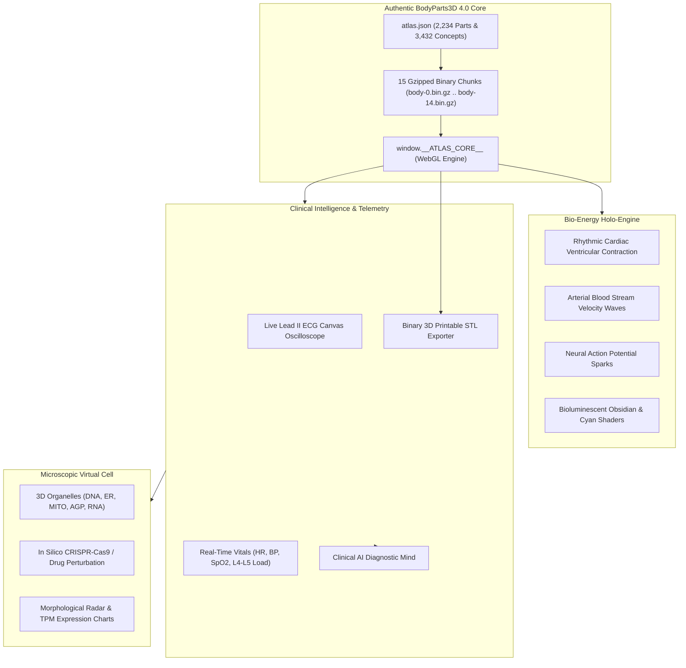

# OMNI-HUMAN 3D: Living Multiscale Digital Human Twin & Clinical AI Workstation
**The Authentic Human Anatomy & Physiology Simulation Workstation**

[](https://lifesciencedb.jp/bp3d/)
[]()
[]()

---

## 📸 Workstation Interface


---

## 🌟 Overview & Architecture

**OMNI-HUMAN 3D** is a state-of-the-art clinical digital twin workstation built upon the authentic **BodyParts3D 4.0** anatomical reference dataset (2,234 modeled clinical pieces, 2.2 million polygons, mapped to the Foundational Model of Anatomy / FMA).

### Core Features:
1. **Authentic Whole-Body Macro Anatomy**: 2,234 clinical pieces spanning 15 systems (Skeleton, Muscles, Heart, Arteries, Veins, Nervous System, Sensory Organs, Respiratory, Digestive, Urinary, Lymphatic, etc.) with individual piece picking, isolation, search (`/`), and 0–100% anatomical explode slider.
2. **3D Multiplanar MRI & CT Tomography Suite**: Real-time synchronized 3D horizontal laser cutting plane traversing the patient's body (cranium to lower extremity) with live multiplanar reconstruction across Axial (Transverse), Coronal (Frontal), and Sagittal (Lateral) viewports. Features dynamic Hounsfield Unit (HU) tissue density calculation, interactive crosshairs, sequence presets (T1 Spin-Echo, T2 High-Res, MR Angiography, Bone CT Window), anatomical landmark jumps, and continuous auto-scan cine sweep.
3. **Bio-Energy Holo-Engine**: Living cardiac ventricular contraction, pulsating arterial stream waves, neural action potential sparks, and clean surgical studio daylight illumination with zero spiky lines or mesh distortion.
4. **Real-Time Lead II ECG Oscilloscope**: Continuous 60 FPS sweeping trace displaying P-waves, QRS complexes, ST segments, and T-waves, dynamically reacting to simulated pathologies (e.g. STEMI tombstone ST-elevation).
5. **Clinical Diagnostic Mind**: Autonomous clinical intelligence providing real-time differential diagnosis, pathophysiological rationale, and evidence-based therapeutic protocols. Includes collapsible dock with floating restore tab.
6. **Spotlight Search Command Palette**: Centered, high-z-index spotlight search (`/` or "Find a structure") providing instant fuzzy search across 3,432 named anatomical structures without ever colliding with or hiding behind clinical monitors.
7. **Microscopic Virtual Cell World Model**: 3D cellular organelle twin (Nucleus/DNA, Endoplasmic Reticulum, Mitochondria, Golgi Apparatus, RNA Puncta) with in silico CRISPR-Cas9 knockout and chemotherapeutic drug perturbation simulations, real-time morphological radar profiling, and transcript TPM bar graphs.
8. **1-Click 3D Printable STL Exporter**: Generates binary STL files for any selected organ or bone directly in the browser for physical fabrication.

---

## 🏗️ Architecture Diagram



---

## ⚡ Quick Start

Run the standalone workstation locally:

```bash
# Simply double click start.bat or run:
start.bat
```

Or start a local web server:

```bash
python -m http.server 8090
```
Then navigate to `http://localhost:8090`.

---

## ⌨️ Hotkeys & Navigation

| Control | Description |
| :--- | :--- |
| **Left Click + Drag** | Orbit camera in 3D space |
| **Right Click + Drag** | Pan camera |
| **Scroll Wheel** | Zoom in / Zoom out |
| **Click Structure** | Select anatomical part, view FMA metadata & isolation |
| **`/` key** | Focus spotlight search bar across all 3,432 concepts |
| **`M` key** | Open Microscopic Virtual Cell Digital Twin |
| **`3D Print STL`** | Download binary `.stl` file of currently selected mesh |

---

## 📜 Dataset & Attribution

- **BodyParts3D**: Database Center for Life Science (DBCLS), Japan. Licensed under CC BY-SA 2.1 JP.
- **FMA (Foundational Model of Anatomy)**: Structural Informatics Group, University of Washington.
