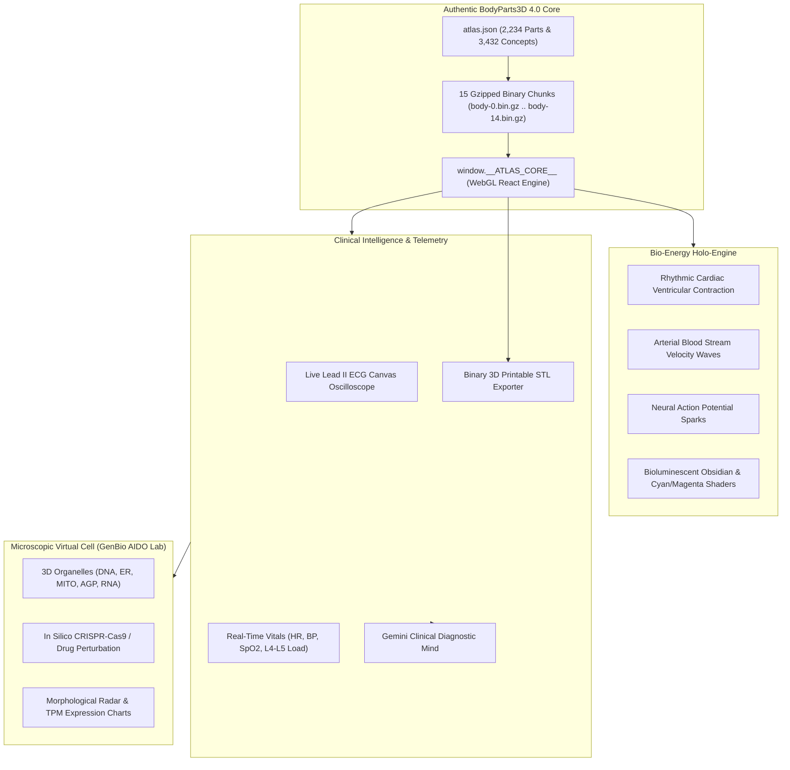

# OMNI-HUMAN 3D: Living Multiscale Digital Human Twin & Clinical AI Workstation
**The Authentic Human Anatomy & Physiology Simulation Workstation — Powered by Google Gemini**

[](https://deepmind.google/technologies/gemini/)
[](https://lifesciencedb.jp/bp3d/)
[]()
[]()

---

## 🌟 Overview & Architecture

**OMNI-HUMAN 3D** is a state-of-the-art clinical digital twin workstation built upon the authentic **BodyParts3D 4.0** anatomical reference dataset (2,234 modeled clinical pieces, 2.2 million polygons, mapped to the Foundational Model of Anatomy / FMA).

It combines:
1. **Authentic Whole-Body Macro Anatomy**: 2,234 clinical pieces spanning 15 systems (Skeleton, Muscles, Heart, Arteries, Veins, Nervous System, Sensory Organs, Respiratory, Digestive, Urinary, Lymphatic, etc.) with individual piece picking, isolation, search (`/`), and 0–100% anatomical explode slider.
2. **3D Multiplanar MRI & CT Tomography Suite**: Real-time synchronized 3D horizontal laser cutting plane traversing the patient's body (cranium to lower extremity) with live multiplanar reconstruction across Axial (Transverse), Coronal (Frontal), and Sagittal (Lateral) viewports. Features dynamic Hounsfield Unit (HU) tissue density calculation, interactive crosshairs, sequence presets (T1 Spin-Echo, T2 High-Res, MR Angiography, Bone CT Window), anatomical landmark jumps, and continuous auto-scan cine sweep.
3. **Bio-Energy Holo-Engine**: Living cardiac ventricular contraction, pulsating arterial stream waves, neural action potential sparks, and clean surgical studio daylight illumination with zero spiky lines or mesh distortion.
4. **Real-Time Lead II ECG Oscilloscope**: Continuous 60 FPS sweeping trace displaying P-waves, QRS complexes, ST segments, and T-waves, dynamically reacting to simulated pathologies (e.g. STEMI tombstone ST-elevation).
5. **Gemini Clinical Diagnostic Mind**: Autonomous clinical intelligence providing real-time differential diagnosis, pathophysiological rationale, and evidence-based therapeutic protocols. Includes collapsible dock with floating restore tab.
6. **Spotlight Search Command Palette**: Centered, high-z-index spotlight search (`/` or "Find a structure") providing instant fuzzy search across 3,432 named anatomical structures without ever colliding with or hiding behind clinical monitors.
7. **Microscopic Virtual Cell World Model (GenBio AIDO Lab)**: 3D cellular organelle twin (Nucleus/DNA, Endoplasmic Reticulum, Mitochondria, Golgi Apparatus, RNA Puncta) with in silico CRISPR-Cas9 knockout and chemotherapeutic drug perturbation simulations, real-time morphological radar profiling, and transcript TPM bar graphs.
8. **1-Click 3D Printable STL Exporter**: Generates binary STL files for any selected organ or bone directly in the browser for physical fabrication.



---

## 🚀 Quick Start

### 1-Click Launch (Windows)
Double-click `start.bat` inside the `OmniHuman-3D` folder:
```cmd
start.bat
```
This automatically starts the high-performance local server at `http://localhost:8090` and launches your default web browser.

### Manual Launch (Any OS)
```bash
cd OmniHuman-3D
python -m http.server 8090
```
Then navigate to:
```
http://localhost:8090
```

---

## 🕹️ Clinical Controls & Features

| Control | Description |
| :--- | :--- |
| **Pathology Selector** | Simulate **Healthy Baseline**, **Acute Anterior STEMI**, **L4-L5 Disc Herniation**, **Tension Pneumothorax**, and **Hepatic Cirrhosis**. |
| **3D Scan (`📡`)** | Launch the multiplanar MRI & CT Tomography Suite with real-time synchronized 3D horizontal laser cutting, Axial/Coronal/Sagittal viewports, T1/T2/Angio/Bone presets, and auto-scan cine sweep. |
| **Explode Slider (0-100%)** | Smoothly separates all 2,234 individual pieces into an organized clinical inventory for surgical inspection. |
| **Systems Checklist** | Filter between 15 systems: Skeleton (296), Muscles (402), Heart (23), Sensory (45), Arteries (639), Veins (404), Nervous (139), Respiratory (119), Digestive (97), Urinary (6), etc. |
| **Search Command Palette (`/`)** | Instant centered spotlight search across 3,432 named anatomical structures (e.g. "Femur", "Coronary artery", "Cerebellum"). |
| **Clinical Dock Minimize (`—`)** | Minimizes the right Gemini Clinical monitor into a compact floating `[ 🩺 Gemini Mind ]` restore button for unobstructed viewport exploration. |
| **Organ Inspection** | Click any bone, muscle, or organ in 3D to view its FMA reference, geometry metrics, and clinical attachments. |
| **3D Print STL** | Click `3D Print STL` on any selected structure to immediately download a watertight, 3D-printable binary STL model. |
| **Micro Cell Twin** | Click `Micro Cell` in the top dock to launch the GenBio AIDO Lab virtual cell with 3D organelles, CRISPR knockouts, and radar charts. |
| **Cinematic Tour** | Click `Tour` for an automated 360-degree orbit around the active anatomical region. |
| **Stethoscope Audio** | Toggle real-time synthesized acoustic S1/S2 heart sounds synchronized with the active heart rate. |

---

## 🏥 Validated Pathophysiological Scenarios

1. **Healthy Physiological Equilibrium**:
   - HR 75 BPM, BP 120/80 mmHg, SpO2 99%, L4-L5 Load 420 N.
   - Normal sinus rhythm with clean Lead II electrophysiological intervals.
2. **Acute Anterior Transmural STEMI**:
   - Occlusion of the Left Anterior Descending (LAD) artery.
   - Characteristic tombstone ST-elevation, hyperacute T-waves, ventricular tachycardia (112 BPM), hypotension (88/56 mmHg), and hypoxia (91% SpO2).
   - Gemini emergent management: Immediate catheterization (PCI < 90 min), DAPT, Heparin, sublingual nitrates.
3. **L4-L5 Posterolateral Lumbar Disc Herniation**:
   - Severe spinal nerve root impingement with acute radiculopathy.
   - Spine axial compressive load exceeds the 3,400 N NIOSH safety threshold (3,650 N).
4. **Tension Pneumothorax (Right Hemithorax)**:
   - Intrapleural air accumulation causing total right lung collapse, severe obstructive shock (HR 138 BPM, BP 80/50 mmHg, SpO2 82%).
   - Immediate emergent needle decompression (14G, 2nd intercostal space midclavicular line) + tube thoracostomy.
5. **Decompensated Hepatic Cirrhosis**:
   - Portal hypertension > 12 mmHg, prolonged QTc intervals (cirrhotic cardiomyopathy), hyperdynamic splanchnic circulation, ascites.

---

## 📄 License & Attribution
- **BodyParts3D**: &copy; The Database Center for Life Science (DBCLS), licensed under [Creative Commons Attribution 4.0 International (CC BY 4.0)](https://creativecommons.org/licenses/by/4.0/).
- **OmniHuman-3D Orchestrator & Shaders**: Engineered for high-fidelity medical AI education and clinical digital twins.
